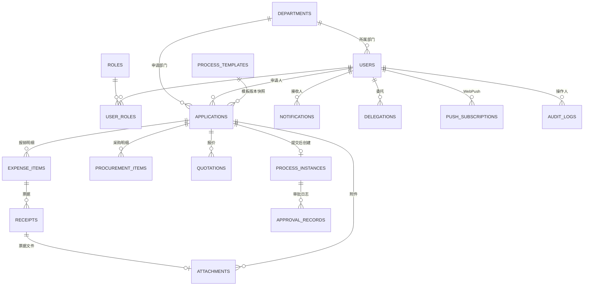

# 企业审批系统（Enterprise Approval System）设计文档

> 《BS体系软件设计》大程 · 设计文档
> 版本：v1.0　日期：2026-11-10

---

## 目录

1. [项目概述](#1-项目概述)
2. [需求对照与功能范围](#2-需求对照与功能范围)
3. [技术选型与总体架构](#3-技术选型与总体架构)
4. [数据库设计](#4-数据库设计)
5. [权限模型设计](#5-权限模型设计)
6. [审批流程引擎设计](#6-审批流程引擎设计)
7. [三类业务审批设计](#7-三类业务审批设计)
8. [管理员自定义流程设计](#8-管理员自定义流程设计)
9. [附件与文件管理设计](#9-附件与文件管理设计)
10. [通知与实时提醒设计](#10-通知与实时提醒设计)
11. [查询统计设计](#11-查询统计设计)
12. [接口设计（REST API）](#12-接口设计rest-api)
13. [前端设计](#13-前端设计)
14. [移动端与提分功能设计](#14-移动端与提分功能设计)
15. [安全设计](#15-安全设计)
16. [部署设计（Docker）](#16-部署设计docker)
17. [验收对照表](#17-验收对照表)

---

## 1. 项目概述

### 1.1 项目背景与目标

独立开发一个可运行的企业审批 Web 应用，覆盖**采购审批、差旅申请、报销审批**三类业务审批，以及**系统管理员自主定义的其他审批流程**（如请假、用章等）。通过多个部门、不同权限的用户，演示申请提交、逐级审批、结果查询和操作留痕的完整过程。

### 1.2 功能范围

| 范围 | 内容 | 本项目实现 |
|------|------|-----------|
| 基础必做 | 用户与部门权限；三类业务审批；可配置的第四类流程；审批状态与历史；查询统计；附件管理；数据库与部署；文档及演示 | ✅ 全部实现 |
| 重点提分 | 移动端完成全部核心操作、界面适配；审批进度变化提醒 | ✅ 响应式移动端适配 + SSE 实时提醒（页面打开自动更新）+ Web Push 后台触达 |
| 可选增强 | 会签、委托、催办、OCR、重复报销预警、流程可视化等（选择少量有完整演示证据的） | ✅ 选择实现：**审批委托**、**催办**、**跨申请重复票据预警**、**可视化流程设计器** |

### 1.3 演示数据说明

系统内置 4 个部门（研发部、市场部、财务部、管理部）与一组演示账号（见《使用手册》），覆盖普通员工、部门负责人、财务审批人、企业负责人、系统管理员五类角色，可直接演示完整审批链路。

---

## 2. 需求对照与功能范围

本节逐条对照《实验要求》（assignment §1.2），说明每项需求在本系统中的实现位置。

### 2.1 通用界面与功能

| # | 需求 | 实现 |
|---|------|------|
| 1 | 注册、登录、退出、个人信息 | 前端 `/login`、`/register`、`/profile`；接口 `POST /api/auth/register|login`、`GET /api/users/me`、`PATCH /api/users/me` |
| 2 | 我的申请、我的待办、已办事项、通知中心入口 | 侧边导航四项入口；接口 `/api/applications`、`/api/tasks`（todo/done）、`/api/notifications` |
| 3 | 管理员独立管理入口 | 拥有 ADMIN 角色时显示"管理后台"导航（独立布局 AdminLayout），前端隐藏 + **服务端逐接口校验** |
| 4 | 草稿保存、校验后提交、查看详情、当前审批人、历史进度 | 表单草稿 `status=DRAFT`；提交时 zod 服务端校验；详情页展示流程时间线（当前节点高亮）与审批日志 |
| 5 | 列表按类型、状态、时间、关键词筛选并分页 | 所有列表接口支持 `type/status/dateFrom/dateTo/keyword/page/pageSize` |
| 6 | 加载、空结果、校验错误、提交成功、操作失败状态 | 前端统一 loading/empty/el-message 组件；服务端统一错误码返回 |
| 7 | 删除、撤回需确认，避免误操作 | 前端 ElMessageBox 二次确认；服务端校验状态机合法性 |
| 8 | 申请编号系统生成且唯一 | 服务端 `app_no` 生成器（类型前缀 + 日期 + 当日自增序号），数据库唯一索引兜底 |
| 9 | 申请人、部门、操作时间由服务端确定 | 均取自 JWT 会话与服务器时钟，客户端不可指定 |
| 10 | 已提交记录及审批日志刷新/重启后仍可查 | 全部持久化于 MySQL |

### 2.2 用户部门与权限

| # | 需求 | 实现 |
|---|------|------|
| 1 | 至少研发部、市场部、财务部 | 种子数据：研发部、市场部、财务部、管理部（管理员所属） |
| 2 | 一人可兼任多角色，角色/部门/数据范围明确 | `user_roles` 多对多；权限矩阵见 §5；数据范围在服务层按角色过滤 |
| 3 | 注册填用户名、姓名、邮箱、密码、申请加入部门；用户名邮箱唯一、前后端校验 | 前端表单校验 + 后端 zod 校验 + 数据库唯一索引三重保障 |
| 4 | 注册用户默认待确认或普通员工；部门归属及高权限角色由管理员确认授予；客户端不能指定管理员/财务/负责人身份 | 注册即普通员工（EMPLOYEE）；注册接口忽略任何角色参数；**申请的部门记入 dept_id 但待管理员确认（dept_confirmed=0，确认前不可提交申请）**；高权限角色由管理员在用户管理页授予；确认/授权/变更均写 audit_logs |
| 5 | 密码 ≥8 位、框架支持哈希、不存明文 | bcrypt（cost=10）存储哈希 |
| 6 | 权限检查必须在服务端执行，覆盖列表、详情、审批、附件预览/下载 | 所有接口通过统一权限中间件 + 服务层数据范围过滤；前端隐藏按钮仅为体验优化 |
| 7 | 不能通过修改请求字段获取额外权限；非当前审批人不能操作待办 | 申请人/部门/金额/审批人一律取自服务端会话与已存快照；审批接口校验 `当前节点审批人 == 当前用户` |

### 2.3 三类业务审批

采购（§2.3.1）、差旅（§2.3.2）、报销（§2.3.3）的字段与规则详见 [§7](#7-三类业务审批设计)。

### 2.4 自定义审批流程

- 模板创建/编辑/启用/停用（§8）；
- 至少内置"请假申请"、"用章申请"两个非三类业务模板，均为数据库驱动的动态表单与流程，**不修改代码即可创建新流程**；
- 发布前校验：字段标识唯一、条件引用有效、节点完整（≥2）、审批人规则有效、无循环（§8.4）。

### 2.5 审批流转

- 状态机（草稿/审批中/已通过/已驳回/已撤回）与转换规则见 §6.2；
- 提交时快照审批路径（节点、规则口径、人员解析结果），模板后续修改不影响已有实例（§6.4）；
- 顺序审批，每节点一名实际审批人；前一节点未通过时后续节点不可审批；
- 驳回必填理由；审批中可撤回；撤回与审批并发仅一方生效（数据库行锁 + 状态条件更新，§6.5）；
- 任何人不能审批自己的申请；
- 重复点击/重试/双浏览器并发审批不产生两次流转（事务 + 条件 UPDATE 幂等，§6.5）；
- 审批日志（申请及版本、节点、操作人、动作、意见、时间、结果）不可被普通用户修改删除；管理员配置与授权变更留痕（audit_logs，§4.2）。

### 2.6 查询统计与基础通知

| # | 需求 | 实现 |
|---|------|------|
| 1 | 个人申请/待办统计 | 首页统计卡片 + ECharts 图表（§11） |
| 2 | 负责人按权限查看本部门各类申请数量、状态分布、审批通过金额 | 部门统计接口（仅部门负责人/企业负责人/管理员可访问），口径按**提交时间**统计，草稿/驳回金额不计入通过金额 |
| 3 | 至少一种图表 | ECharts 柱状图 + 饼图（§11.3） |
| 4 | 持久化站内通知（新待办/通过/驳回/撤回） | `notifications` 表；`biz_key` 唯一索引防重（§10.2） |
| 5 | 未读数量、标记已读、跳转详情 | 顶栏红点 + 通知中心；`PATCH /api/notifications/:id/read`；点击跳转申请详情 |
| 6 | 非当前用户的通知不得读取/标记 | 服务端强制 `user_id = 当前用户` 过滤 |
| 7 | 页面打开更新可采用轮询 | 采用 SSE 实时推送 + 断线自动重连（优于轮询），轮询逻辑仅作兜底 |

---

## 3. 技术选型与总体架构

### 3.1 技术选型

| 层 | 技术 | 说明 |
|----|------|------|
| 前端 | Vue 3 + Vite + Pinia + Vue Router + Element Plus + ECharts + Axios + dayjs | 前后端分离 SPA；响应式布局适配移动端 |
| 后端 | Node.js 20 + Express 4（ESM） | REST API；中间件式权限校验 |
| 认证 | JWT（access token，7 天有效期）+ bcrypt | 无状态认证，SSE 通过 query token 鉴权 |
| 数据库 | MySQL 8.0（utf8mb4） | mysql2 连接池；金额一律整数"分"存储 |
| 校验 | zod | 前端规则同步（人类可读提示）+ 服务端强校验 |
| 文件 | multer 本地磁盘存储（挂载卷） | 文件名随机化，MD5 摘要入库 |
| 实时 | SSE（Server-Sent Events） | 通知 + 待办变化实时推送；Web Push（web-push/VAPID）作为后台触达可选增强 |
| 部署 | Docker Compose（mysql + backend + frontend/nginx） | 一键可复现部署 |

### 3.2 总体架构

```
┌─────────────────────────── 浏览器 / 手机浏览器 ───────────────────────────┐
│  Vue 3 SPA（Nginx 托管）                                                  │
│   ├─ 页面/表单（Element Plus 响应式）                                      │
│   ├─ Pinia 状态（auth、notifications）                                    │
│   ├─ EventSource（SSE：通知/待办变化） + Service Worker（Web Push 可选）    │
│   └─ axios（REST + JWT）                                                  │
└───────────────┬───────────────────────────────────────────────────────────┘
                │ HTTPS/HTTP  /api 与 /uploads 反向代理
┌───────────────▼───────────────────────────────────────────────────────────┐
│  frontend 容器（nginx）  静态资源 + 反向代理 → backend:3000                 │
└───────────────┬───────────────────────────────────────────────────────────┘
┌───────────────▼───────────────────────────────────────────────────────────┐
│  backend 容器（Node.js 20 + Express）                                      │
│   ├─ routes      ：REST 路由                                              │
│   ├─ services    ：审批流转引擎 / 模板引擎 / 通知 / 统计 / 票据检测          │
│   ├─ middleware  ：JWT 认证、角色/权限、zod 校验、错误处理                   │
│   └─ utils       ：编号生成、密码哈希、MD5、SSE Hub                        │
└───────────────┬───────────────────────────────────────────────────────────┘
┌───────────────▼───────────────────────────────────────────────────────────┐
│  mysql 容器（MySQL 8.0）  ├─ 业务库 approval_db                             │
│  ├─ /docker-entrypoint-initdb.d：01_schema.sql、02_seed.sql（可重复执行）    │
│  ├─ 数据卷 volume：数据库文件                                              │
│  └─ 上传文件卷 volume（backend 挂载 /app/uploads）                         │
└───────────────────────────────────────────────────────────────────────────┘
```

### 3.3 目录结构

```
bs软件体系设计/
├── docs/
│   ├── 设计文档.md          # 本文档
│   └── 使用手册.md          # 部署、演示脚本、账号说明
├── backend/                # Node.js + Express 后端
│   ├── src/
│   │   ├── server.js       # 入口
│   │   ├── config.js       # 环境配置
│   │   ├── db.js           # 连接池/事务助手
│   │   ├── errors.js       # 统一错误
│   │   ├── middleware/     # auth / validate
│   │   ├── routes/         # REST 路由
│   │   ├── services/       # 业务服务层
│   │   ├── validators/     # zod 校验
│   │   └── utils/
│   ├── sql/init/           # 建表与种子 SQL（挂载进 mysql 容器）
│   ├── Dockerfile
│   └── package.json
├── frontend/               # Vue 3 前端
│   ├── src/{api,views,components,layouts,router,stores,utils}
│   ├── nginx.conf          # SPA + 反向代理
│   ├── Dockerfile
│   └── package.json
├── docker-compose.yml
└── README.md
```

---

## 4. 数据库设计

数据库：MySQL 8.0，库名 `approval_db`，字符集 `utf8mb4`。建表脚本 `backend/sql/init/01_schema.sql`，种子数据 `backend/sql/init/02_seed.sql`，挂载至 mysql 容器 `/docker-entrypoint-initdb.d/` 首次启动自动执行（幂等，可重复运行）。

### 4.1 ER 图（逻辑模型）



### 4.2 表结构清单

**users — 用户**

| 字段 | 类型 | 约束/说明 |
|------|------|-----------|
| id | BIGINT UNSIGNED PK AUTO_INCREMENT | |
| username | VARCHAR(32) | UNIQUE，3–20 位字母数字下划线 |
| email | VARCHAR(128) | UNIQUE |
| password_hash | VARCHAR(100) | bcrypt |
| name | VARCHAR(32) | 姓名 |
| dept_id | BIGINT UNSIGNED FK→departments | 所属部门 |
| dept_confirmed | TINYINT | 部门归属是否经管理员确认（注册时申请部门记入 dept_id 但 dept_confirmed=0；管理员确认后置 1，写 audit_logs；确认前不能提交申请） |
| status | ENUM('ACTIVE','DISABLED') | 注册即 ACTIVE（普通员工） |
| created_at / updated_at | DATETIME | |

**departments — 部门**：id、name UNIQUE、description、created_at。

**roles — 角色（固定集，种子数据）**：id、code UNIQUE（`EMPLOYEE`/`DEPT_HEAD`/`FINANCE`/`COMPANY_HEAD`/`ADMIN`）、name。

**user_roles — 用户角色（多对多）**：user_id、role_id，联合主键 (user_id, role_id)。**删除策略**：用户删除时级联删除。

**process_templates — 流程模板（含版本）**

| 字段 | 说明 |
|------|------|
| id | PK |
| code | 业务类型码：`procurement`/`travel`/`reimbursement`/`custom_*`（自定义） |
| name / description | |
| category | `BUILTIN`（三类业务，不可编辑不可删除）/ `CUSTOM` |
| applicable_depts | JSON：适用部门 id 数组（空数组 = 全部部门）。员工端"发起申请"仅展示适用本人部门的已启用模板；发布校验检查部门 id 合法 |
| form_schema | JSON：表单字段定义（§8.2） |
| flow_config | JSON：审批节点定义（§8.3） |
| version | 每次发布 +1（发布即新版本，同 id 保留） |
| status | `DRAFT`/`PUBLISHED`/`DISABLED` |
| created_by / created_at / updated_at | |

> 版本策略：同一模板每次"发布"生成 version+1 的新版本行（保留历史版本供已提交实例引用快照）；启用/停用只作用于最新发布版本；内置三类模板以种子数据形式提供，管理员可编辑其节点规则（如阈值节点）。

**applications — 申请主表（三类业务 + 自定义共用）**

| 字段 | 说明 |
|------|------|
| id | PK |
| app_no | 申请编号 UNIQUE（服务端生成，如 `CG20261110-0001`） |
| type | `PROCUREMENT`/`TRAVEL`/`REIMBURSEMENT`/`CUSTOM` |
| template_id / template_version | 提交时所用模板及版本 |
| applicant_id | FK→users（取会话） |
| dept_id | 提交时申请人的部门（快照） |
| title | 标题 |
| form_data | JSON：类型专属字段（差旅、采购头信息、自定义表单值等） |
| status | `DRAFT`/`IN_APPROVAL`/`APPROVED`/`REJECTED`/`WITHDRAWN` |
| total_amount_cents | 系统计算金额（分），差旅为预算、报销为合计、采购为拟选供应商总额 |
| linked_application_id | 报销关联的本人已批准差旅/采购申请（独立列，详情展示对应差旅信息） |
| source_application_id | 驳回/撤回后"复制重提"的原单关联 |
| current_instance_id | 当前流程实例 |
| created_at / submitted_at / finished_at | 提交时间口径：`submitted_at` |

**procurement_items — 采购明细**：application_id FK（**级联删除**）、name、spec、quantity、unit、unit_price_cents、amount_cents、sort。

**quotations — 报价比较**：application_id FK（级联删除）、supplier_name、quote_date、quote_amount_cents、quote_detail、purchase_link、is_single_source、selected（拟选标记）、select_reason、attachment_id FK→attachments（报价依据）。

**expense_items — 报销明细**：application_id FK（级联删除）、expense_type ENUM(`TRAFFIC`,`HOTEL`,`MEAL`,`OFFICE`,`OTHER`)、occur_date、purpose、amount_cents、no_receipt（无票例外标志）、no_receipt_reason、sort。

**receipts — 票据记录**：expense_item_id FK（级联删除）、receipt_no（可空）、attachment_id FK→attachments、created_at。同单内 (expense_item_id, receipt_no) 与 (expense_item_id, attachment_id) 唯一。

**attachments — 附件**：id、application_id FK（**级联删除**）、biz_type（`QUOTATION`/`RECEIPT`/`TRAVEL`/`CUSTOM`/`OTHER`）、original_name、stored_name（随机文件名）、mime、size_bytes、md5（用于重复票据预警）、uploaded_by FK、uploaded_at。

**process_instances — 流程实例（提交时快照）**

| 字段 | 说明 |
|------|------|
| id | PK |
| application_id | FK（级联删除） |
| template_id / template_version | 快照版本 |
| flow_snapshot | JSON：节点数组快照（node_name、approver_rule、resolved_user_id、delegated_from、order、threshold 口径） |
| current_node_idx | 当前节点下标 |
| status | `IN_APPROVAL`/`APPROVED`/`REJECTED`/`WITHDRAWN` |
| submitted_at / finished_at | |

**approval_records — 审批日志（只追加，不可改删）**：id、instance_id FK（级联删除）、application_id、node_idx、node_name、approver_user_id（节点实际审批人快照）、acted_by（操作人，委托时≠审批人）、action ENUM(`SUBMIT`,`APPROVE`,`REJECT`,`WITHDRAW`,`REJECT_WITHDRAW`)…（含 `DELEGATE` 说明）、comment、result（`PASS`/`REJECT`/`WITHDRAW`）、created_at。

**notifications — 站内通知**：id、user_id FK（级联删除）、type（`TODO`/`APPROVED`/`REJECTED`/`WITHDRAWN`/`REMIND`/`SYSTEM`）、title、content、link（前端跳转路径）、is_read、biz_key、created_at。**UNIQUE(user_id, biz_key)** 保证同一业务变化重试不重复生成通知。

**delegations — 审批委托**：id、user_id（委托人）、delegatee_id（受托人）、start_time、end_time、enabled、reason、created_at。**创建校验**：受托人为启用用户且非本人；**生效口径**：提交时解析节点审批人时应用——角色类节点（FINANCE/COMPANY_HEAD/DEPT_HEAD）的受托人必须持有该节点对应角色（DEPT_HEAD 还须同部门），防止把财务/高金额审批权委托给未授权员工；受托人为该申请申请人时拒绝提交并提示。

**stats_grants — 统计授权（"明确授权"留痕）**：id、user_id、scope ENUM(`FINANCE`,`COMPANY`)（FINANCE=授权的财务统计：报销+采购全部门；COMPANY=企业范围统计：全部部门全部类型）、granted_by、created_at、UNIQUE(user_id, scope)。仅管理员可授予/收回（audit_logs 留痕）。企业负责人/财务审批人**不因角色自动获得企业范围统计**。

**push_subscriptions — Web Push 订阅**：id、user_id、endpoint、keys（JSON）、created_at。

**audit_logs — 系统管理留痕**：id、operator_id、action（`GRANT_ROLE`/`CHANGE_DEPT`/`UPDATE_USER`/`CREATE_TEMPLATE`/`PUBLISH_TEMPLATE`/`UPDATE_CONFIG`…）、target_type、target_id、detail（JSON）、created_at。管理员配置与授权变更一律写此表，管理后台可查。

**system_configs — 系统配置**：key PK、value、description。默认项：`company_head_threshold_cents`（企业负责人加签金额阈值，默认 100000 元）、`receipt.max_count`（20）、`receipt.max_total_mb`（100）、`receipt.max_size_mb`（10）、`push.enabled`。

**app_no_seq — 编号序列表**：type、date、seq，联合主键 (type, date)；`SELECT ... FOR UPDATE` 保证并发唯一。

### 4.3 关联与删除策略汇总

| 关系 | 策略 | 理由 |
|------|------|------|
| users → user_roles / notifications / delegations / push_subscriptions / audit_logs | 级联删除 | 用户删除后其个人数据无保留意义 |
| applications → 明细表 / 实例 / 附件 | 级联删除 | 仅草稿可删（删除即彻底删除）；已提交单据不可删除 |
| process_instances → approval_records | 级联删除（实际不触发，已提交单不可删） | 一致性兜底 |
| users → applications / approval_records / audit_logs | 不级联（外键约束禁止删除有业务数据的用户） | 留痕完整性；停用账号改用 `status=DISABLED` |

---

## 5. 权限模型设计

### 5.1 角色定义

| 角色 | code | 主要操作 | 数据范围 |
|------|------|----------|----------|
| 普通员工 | EMPLOYEE | 提交三类业务及自定义申请；查看进度；撤回 | 仅本人申请 |
| 部门负责人 | DEPT_HEAD | 处理本部门分配节点的审批任务；本部门统计 | 本人 + 本部门统计；跨部门数据须企业范围授权 |
| 财务审批人 | FINANCE | 预算审查、报销财务审核节点 | 分配给自己的任务 + 经 stats_grants 授权的财务统计（报销+采购口径） |
| 企业负责人 | COMPANY_HEAD | 高金额/特定流程审批；企业范围统计 | 分配给自己的任务 + 经 stats_grants 授权的企业统计（不因角色自动获得） |
| 系统管理员 | ADMIN | 部门/用户/角色/模板/配置/统计授权管理 | 管理数据；**不**自动获得审批权与业务正文/票据查看权。查看某申请业务内容的唯一途径：被流程模板"指定用户"规则解析为审批人（即"另行授权"=进入审批链，留痕于审批日志）；纯管理角色一律不可读业务正文与票据文件 |

### 5.2 权限矩阵（服务端强制）

| 能力 | EMPLOYEE | DEPT_HEAD | FINANCE | COMPANY_HEAD | ADMIN |
|------|:---:|:---:|:---:|:---:|:---:|
| 提交/撤回/删除草稿（仅本人） | ✅ | ✅ | ✅ | ✅ | ✅ |
| 查看申请详情（本人，或审批日志中出现的节点审批人） | 本人 | +本部门已通过统计口径内详情* | 本人 | 本人 | — |
| 审批待办（仅当前节点审批人） | — | ✅ | ✅ | ✅ | — |
| 个人统计 | ✅ | ✅ | ✅ | ✅ | ✅ |
| 部门统计 | — | 本部门 | 经 stats_grants 授权的财务统计 | 经 stats_grants 授权的企业统计 | ✅ |
| 用户/部门/角色/模板/配置/统计授权/审计日志管理 | — | — | — | — | ✅ |
| 附件预览/下载 | 本人相关 | 本人相关 | 本人相关 | 本人相关 | —（须在审批链中） |

> \* 负责人查看本部门数据仅限"统计查询"接口（聚合口径，不含他人票据与正文）；详情页与附件访问权限 = 申请人本人、当前/历史节点审批人（含受托代办人）。**管理员默认不可访问任何业务正文与附件**，唯一途径是被模板节点"指定用户"规则纳入审批链（另行授权、留痕）。**管理权限 ≠ 审批权限** 在代码层显式体现：`requireRole('ADMIN')` 与业务数据访问检查相互独立。

### 5.3 服务端权限实施机制

1. **认证**：JWT Bearer token；`authMiddleware` 解析并加载用户（含角色、部门），无效/停用即 401。
2. **接口级**：`requireRole(...)` 中间件；管理接口全部 `/api/admin/*` 前缀 + ADMIN 检查。
3. **数据级**：所有列表/详情查询在 SQL WHERE 中强制注入数据范围条件（本人、或本人为节点审批人），**不依赖前端传参过滤**。
4. **字段级**：提交类接口的 `applicant_id`、`dept_id`、`total_amount_cents`、审批人字段一律忽略客户端值，由服务端从会话与数据库/快照取值并重算。
5. **审批操作**：仅当 `flow_snapshot[current_node_idx].resolved_user_id === 当前用户 id` 时允许；且禁止审批自己的申请（`applicant_id !== 当前用户`）。
6. **附件**：下载/预览接口按 §9.4 权限规则校验。

---

## 6. 审批流程引擎设计

### 6.1 概念模型

- **模板（Template）**：表单定义 + 节点规则（可能含"金额阈值"条件节点）。
- **实例（Instance）**：提交时由模板解析为**具体节点列表**并快照——角色规则解析到具体用户（如"申请人部门负责人"→ 提交时查询该部门的 DEPT_HEAD 用户）。
- **任务（Task）**：`current_node_idx` 指向的节点即当前待办；`GET /api/tasks?scope=todo` 查询"我"为 `resolved_user_id` 且实例 `IN_APPROVAL` 的实例。

### 6.2 状态机

```
                 ┌────────────── 申请人撤回 ──────────────┐
                 ▼                                        │
  草稿 ──提交──▶ 审批中 ──当前节点批准──▶ 下一节点 …全部通过──▶ 已通过（终态，只读）
 (DRAFT)        (IN_APPROVAL)  │                          (APPROVED)
    │编辑/删除                  └──任一节点驳回(必填理由)──▶ 已驳回（终态）
    ▼                                                     (REJECTED)
  删除(仅草稿)
```
- 已通过：保留原记录，不可再审/改回草稿；
- 已驳回/已撤回：可"复制修改后重新提交"，生成**新申请**（新编号），通过 `source_application_id` 与原记录关联；
- 撤回：原待办全部失效，原审批历史保留。

| 状态 | 允许操作 |
|------|----------|
| DRAFT | 申请人编辑、删除、提交 |
| IN_APPROVAL | 当前审批人批准/驳回；申请人撤回/催办 |
| APPROVED | 授权用户查询、下载 |
| REJECTED | 查询理由；复制重提 |
| WITHDRAWN | 查询历史；复制重提 |

### 6.3 三类固定流程（节点规则）

| 业务 | 节点序列 | 说明 |
|------|----------|------|
| 采购 | 部门负责人 → 财务审批人（预算审查）→ [金额 ≥ 阈值: 企业负责人] → 通过 | 单源采购在审批界面明确标注 |
| 差旅 | 部门负责人 → [金额(预算) ≥ 阈值: 企业负责人] → 通过 | |
| 报销 | 部门负责人 → 财务审批人（票据/财务审核）→ [金额 ≥ 阈值: 企业负责人] → 通过 | 无票支出在财务审核界面突出显示 |

- 阈值来自 `system_configs.company_head_threshold_cents`（默认 ¥100,000，即 10,000,000 分），管理员可调整；
- 提交时按当时配置解析并快照，后续调整不影响已提交实例；
- 节点审批人规则解析：`DEPT_HEAD`→申请人部门的负责人用户（取该部门拥有 DEPT_HEAD 角色的启用用户，多人时按用户名排序取第一个——确定口径并记录于快照）；`FINANCE`→财务审批人（同口径）；`COMPANY_HEAD`→企业负责人（同口径）；`SPECIFIED_USER`→指定用户；
- **解析排除申请人**：任何节点解析结果（含委托后）为申请人本人时，提交直接报错并提示（"任何人不得审批自己的申请"；可通过审批委托或管理员调整流程解决），不产生卡死流程；
- **相邻节点合并**：解析完成后，若相邻两个节点解析到同一实际审批人，则合并为一个节点（名称拼接）写入快照——既避免"同一人连续审批两节点"，也从机制上杜绝"双击把两个节点都审批掉"的并发漏洞（§6.5）。

### 6.4 快照与版本隔离

- 提交事务内：读取模板最新 PUBLISHED 版本 → 解析节点（含委托替换，§14.2）→ 写入 `process_instances.flow_snapshot`（JSON 全量：节点名、规则、解析人、阈值口径、模板版本）。
- 后续模板编辑/停用/阈值调整**只影响新提交**，已有实例按快照执行。
- 转办（管理员）：记录原因与人员变更，写审批日志与 audit_logs。

### 6.5 并发与幂等控制

1. **提交幂等**：提交操作 `UPDATE applications SET status='IN_APPROVAL' WHERE id=? AND status='DRAFT'`，受影响行数=0 即"状态已变化"，返回业务错误（防止双击双提交）。
2. **审批/撤回并发**：所有流转操作（approve/reject/withdraw）按统一锁序 `applications → process_instances` 在**同一事务**内加 `FOR UPDATE`；`applications.status` 与 `process_instances.status` 用**条件 UPDATE（`WHERE status='IN_APPROVAL'`）**同步更新并写入审批日志，任一失败整体回滚——双方并发时后到者看到状态已变化，仅一方成功。
3. **重复点击/网络重试**：同上行锁；同一节点审批后 `current_node_idx` 前进，二次请求校验"当前节点审批人 == 我"失败 → 返回"任务已被处理"。相邻节点解析到同一人的情况在提交时已合并（§6.3），因此"双击连审两节点"在机制上不可能发生。
4. **通知防重**：`biz_key`（如 `TODO:instance:12:node:2:user:7`）唯一索引，通知插入 `INSERT IGNORE`。
5. **编号唯一**：`app_no_seq` 行锁 + 唯一索引兜底。
6. **金额精度**：全链路整数分（cents）存储与运算，前端展示时除以 100 格式化，杜绝浮点误差影响审批路径。

---

## 7. 三类业务审批设计

### 7.1 采购审批（PROCUREMENT）

**申请信息**：标题、采购原因、期望到货日期、所属部门或项目、预算上限（分）、备注。

**采购明细**（表 procurement_items，≥2 条）：物品/服务名称、规格、数量、单位、预计单价、金额（=数量×单价，服务端重算）。

**报价比较**（表 quotations）：≥2 家供应商（名称、报价日期、报价金额或明细、报价附件/依据；线上购买需购买链接+截图）；**确无法提供两家报价时允许"单一来源采购"**（`is_single_source` + 说明，审批界面明确显示）。

**拟选供应商**：选择理由必填；**未选最低价时必须说明理由**（服务端校验：selected 报价 > 最低报价且无理由 → 拒绝）。预计采购总额 = 拟选供应商报价金额。

**校验规则汇总**：明细 ≥2 且金额>0；报价 ≥2 或单源说明；选择理由必填；非最低价须说明；预算上限 ≥0。

### 7.2 差旅申请（TRAVEL）

**字段**：标题、目的地、出发地点、开始时间、结束时间、出差目的、同行人员（文本或系统用户多选）、交通方式、费用预算（分）、补充附件。

**校验**：结束 ≥ 开始；预算 ≥ 0；目的地/出发地/目的必填。

**天数口径**：系统计算出差天数 = `ceil((结束时刻 − 开始时刻) / 24小时)`，不足 24 小时按 1 天计（**自然日-时长口径**，起止当天合并计）。口径在详情页明确展示（"出差天数（系统按实际时长折算，不足一天按一天计）：N 天"）。

**关联**：已批准的差旅可在报销单中被选择关联，报销详情展示对应差旅信息（目的地、时间、天数、预算）。

### 7.3 报销审批（REIMBURSEMENT）

**报销单**：标题、报销说明、报销人及部门（服务端确定）、关联申请（本人已批准的差旅/采购，可选；允许独立报销+说明）、备注、合计金额（**系统计算** = 有效明细金额之和）。

**费用明细**（表 expense_items，≥3 条，可增删改）：类型（TRAFFIC/HOTEL/MEAL/OFFICE/OTHER）、发生日期、用途说明、金额。

**票据规则**：

| 规则 | 实现 |
|------|------|
| 合计 = 明细之和，客户端即时合计 + 服务端重算 | 前端 watch 实时合计；服务端 zod+重算比对，不一致拒绝 |
| 明细金额 > 0；日期/类型有效；空明细不能提交 | zod 校验 |
| 同一报销单内不能重复使用同一票据记录 | 票据号（非空）+ 文件 MD5 双唯一校验 |
| 每条明细默认 ≥1 份票据 | 校验；无票支出须勾选"无票"并填写原因 |
| 无票支出在财务审核界面突出显示 | 详情/审批页对 no_receipt 明细红色高亮展示 |
| 票据支持 JPEG/PNG/PDF，单文件 ≤10MB，限制数量与总大小 | multer 过滤 + 大小限制（单文件 10MB、单表单 ≤20 个文件、总计 ≤100MB，配置项可调） |
| 预览/下载校验当前用户对该报销单的访问权限 | §9.4 |

**跨申请重复票据预警（增强功能）**：检测范围为**全公司**其他报销单（票据号 OR 文件 MD5 命中即警告）。双通道：提交时在响应中返回警告列表；**财务审核打开详情时实时重算**并在审核界面高亮（无需持久化、随时可查）。同单内重复则**直接拒绝**（规则表第 4 行），与跨单警告的边界明确。

---

## 8. 管理员自定义流程设计

### 8.1 概览

管理后台"流程模板"页：创建/编辑/发布/停用/启用模板。模板包含**名称、说明、适用部门（多选，空=全部部门）、版本和启用状态**。员工在"发起申请"页只能看到**适用本人部门且已启用（PUBLISHED）**的模板。内置种子模板：请假申请（2 节点：部门负责人 → 指定用户/企业负责人）、用章申请（2 节点：部门负责人 → 企业负责人）。**新增流程零代码**：管理界面配置即可，员工端自动渲染。

### 8.2 表单字段定义（form_schema JSON）

支持字段类型：`text`（单行）、`textarea`（多行）、`number`（数字）、`amount`（金额，分）、`date`、`radio`（单选）、`attachment`（附件）。字段属性：

```json
{
  "fields": [
    { "id": "reason", "type": "text", "label": "请假事由", "required": true, "placeholder": "…" },
    { "id": "days", "type": "number", "label": "天数", "required": true,
      "rules": { "min": 0.5, "max": 30 } },
    { "id": "kind", "type": "radio", "label": "假别", "required": true,
      "options": ["年假", "事假", "病假"] },
    { "id": "start", "type": "date", "label": "开始日期", "required": true },
    { "id": "proof", "type": "attachment", "label": "证明材料", "required": false,
      "condition": { "field": "kind", "op": "eq", "value": "病假" } }
  ]
}
```

- 每个字段必有唯一 `id`（`^[a-z][a-z0-9_]*$`）；
- `number/amount` 支持 `min/max`；`date` 支持 `min/max`（"YYYY-MM-DD"）；
- **条件引用（显隐）**：`condition` 引用同表其他字段（`eq/neq/gt/lt/in`），发布校验引用有效且无循环依赖；
- 条件显隐仅控制展示，被隐藏字段的必填校验自动跳过。

### 8.3 流程节点定义（flow_config JSON）

```json
{
  "nodes": [
    { "name": "部门审批", "rule": { "type": "DEPT_HEAD" } },
    { "name": "总经理审批", "rule": { "type": "SPECIFIED_USER", "user_id": 8 } }
  ]
}
```

- 节点数 ≥2，可增删、调整顺序（**可视化流程设计器**：节点卡片 + 箭头连线，上下移动排序）；
- 审批人规则类型：`DEPT_HEAD`（申请人所在部门负责人）、`FINANCE`（财务审批人）、`COMPANY_HEAD`（企业负责人）、`SPECIFIED_USER`（指定用户）；
- 顺序执行：前一节点通过前，后续节点不可审批（引擎按 `current_node_idx` 顺序推进）。

### 8.4 发布前校验（服务端，templateService.validateForPublish）

1. 表单字段 `id` 唯一、合法；
2. 字段 `condition.field` 引用的字段存在，且条件引用无环（递归链深度校验）；
3. 节点数 ≥2，节点名称非空且不重复；
4. 每个节点审批人规则有效（`SPECIFIED_USER` 的用户存在且启用；角色规则合法）；
5. 表单必填字段与规则配置完整；
6. **适用部门 id 均存在**（applicable_depts 合法）。
不通过则返回具体错误清单，禁止发布。发布 = 新版本（version+1）置为 PUBLISHED，旧版本自动停用；停用/启用只影响新提交。内置三类流程模板（BUILTIN）不可编辑、不可停用；其"阈值节点"由系统配置（§6.3）驱动，不属于模板节点配置。

### 8.5 自定义申请执行

- 提交：按 form_schema 动态 zod 校验（类型、必填、范围）→ 生成 `form_data` JSON → 走统一流程引擎（§6）；
- 详情：前端按模板 form_schema 动态渲染只读表单 + 流程时间线；
- 自定义流程的附件字段统一入 attachments 表（biz_type=CUSTOM）。

---

## 9. 附件与文件管理设计

### 9.1 存储

- 上传：multer 接收（`multipart/form-data`），文件重命名为 `<uuid>.<ext>` 存 `uploads/`（容器挂载卷 `approval-uploads`），元数据入 `attachments` 表；
- 限制：MIME 白名单 `image/jpeg|image/png|application/pdf` + 扩展名校验；单文件 ≤10MB；单申请 ≤20 个文件；总大小 ≤100MB（配置项）；
- 上传接口：先有申请（草稿）才能上传（`POST /api/attachments` 携带 `application_id`，校验申请人是当前用户），删除仅限草稿阶段（`DELETE /api/attachments/:id`）。

### 9.2 票据（receipts）

报销明细关联票据：上传文件 + 可选票据号。票据记录保留文件名、上传人、上传时间（表 receipts + attachments）。

### 9.3 MD5 与重复检测

上传时计算文件 MD5 存 `attachments.md5`；报销提交时：同单内（票据号 OR MD5）重复 → 拒绝；跨单重复 → 警告列表（增强功能"跨申请重复票据预警"）。

### 9.4 预览与下载权限

`GET /api/attachments/:id/content`（预览，inline）与 `GET /api/attachments/:id/download`（attachment）统一鉴权：**申请人本人**，或该申请**当前/历史节点审批人（含受托代办人）**。**ADMIN 默认一律拒绝**（管理权限 ≠ 审批权限；业务正文与票据须另行授权——管理员仅在被模板"指定用户"规则纳入审批链时可访问）。越权一律 403。文件内容不经过前端静态目录，避免绕过鉴权。

**上传时 biz_type 由服务端校验与申请类型一致**（RECEIPT 仅限报销、QUOTATION 仅限采购、TRAVEL/CUSTOM 对应各自类型），防止把票据文件伪装成其他类型绕过票据规则；非草稿状态禁止上传。

---

## 10. 通知与实时提醒设计

### 10.1 通知生成点

| 事件 | 通知对象 | biz_key |
|------|----------|---------|
| 提交后产生新待办 | 当前节点审批人 | `TODO:inst:{instanceId}:node:{idx}:user:{uid}` |
| 申请通过 | 申请人 | `APPROVED:app:{applicationId}:user:{uid}` |
| 申请驳回 | 申请人 | `REJECTED:app:{applicationId}:user:{uid}` |
| 申请被撤回 | 当前节点审批人（待办失效） | `WITHDRAWN:app:{applicationId}:user:{uid}` |
| 催办 | 当前节点审批人 | `REMIND:inst:{instanceId}:node:{idx}:user:{uid}`（每节点限 1 次） |

### 10.2 持久化与防重

- `notifications` 表持久化，`UNIQUE(user_id, biz_key)` + `INSERT IGNORE`：同一次业务变化因请求重试不产生重复通知；
- 读取/标记已读强制 `user_id = 当前用户`（`GET/PATCH /api/notifications`）；
- 未读数接口供顶栏红点；通知中心支持全部/未读筛选、标记已读、点击跳转申请详情。

### 10.3 实时推送（SSE）

- 认证采用**短期一次性票据**：`GET /api/notifications/stream-ticket`（Header 认证）换取 **60 秒有效**的专用 ticket；`GET /api/notifications/stream?ticket=xxx` 仅凭 ticket 建立连接（EventSource 无法自定义请求头）。**7 天 JWT 不进入 URL**，避免泄入 nginx 访问日志/浏览器历史；
- 服务端 `SseHub` 按 user_id 维护连接；通知落库后立即推送 `notification` 事件（含未读数）；待办/结果变化推送 `refresh` 事件（前端据此自动刷新待办/申请/统计列表——满足"手机页面打开时自动显示待办或结果变化，无需手动刷新"）；
- 30s 心跳保活；前端断线自动重连（ticket 过期则重新换取）；SSE 不可用时降级 30s 轮询未读数；
- nginx 对该路径专属配置：`proxy_buffering off; proxy_cache off; proxy_read_timeout 3600s;` 响应头 `X-Accel-Buffering: no`，并关闭该路径 access_log（§16.2）。

### 10.4 Web Push（可选增强，后台触达）

- 前端：Service Worker + Push API 订阅（用户授权）；`POST /api/push/subscribe` 存订阅；
- 后端：`web-push`（VAPID），通知生成时若接收人已订阅且 `push.enabled=true` 则发送推送（失败静默降级，**站内通知仍可查询**）；
- 配置与演示证据见《使用手册》；拒绝通知权限不影响任何功能。

---

## 11. 查询统计设计

### 11.1 个人统计（`GET /api/stats/personal`）

- 我的申请总数、审批中、已通过、已驳回、已撤回；
- 我的待办数、已办数；
- 近 6 个月我提交的申请趋势（按 `submitted_at` 月份）；
- 我的申请状态分布（饼图）。

### 11.2 部门/企业统计（`GET /api/stats/dept?deptId=`）

- 权限（**"明确授权"机制**，见 stats_grants 表）：
  - DEPT_HEAD：本部门（角色自带，对应"查询本部门审批情况"）；
  - FINANCE：须管理员授予 `FINANCE` 统计授权 → 财务统计口径（报销+采购，全部部门）；
  - COMPANY_HEAD：须管理员授予 `COMPANY` 统计授权 → 企业范围统计（全部部门全部类型）；**不因角色自动获得**；
  - ADMIN：全部（管理职责）；
  - 授予/收回操作写 audit_logs；
- 指标：各部门/全公司各类申请数量、状态分布、**已通过金额**；
- **口径**（页面明确标注）：按**提交时间（submitted_at）**统计已通过申请金额；**草稿与驳回/撤回金额不计入已通过金额**；金额为该申请的 `total_amount_cents`；
- 趋势图：近 6 个月已通过金额柱状图 + 类型状态分布堆叠图。

### 11.3 图表

- ECharts：个人页（状态分布环形图 + 提交趋势折线/柱状图）；管理统计页（已通过金额月度柱状图 + 类型状态分布堆叠柱状图）。满足"至少一种图表"要求并提供直观展示。

---

## 12. 接口设计（REST API）

统一前缀 `/api`；JSON 通信；认证 `Authorization: Bearer <JWT>`。统一响应：`{ code: 0, data, message }`；错误 `{ code: 4xx/5xx, message, errors? }`。

### 12.1 认证与用户

| 方法 | 路径 | 说明 | 权限 |
|------|------|------|------|
| POST | /api/auth/register | 注册（用户名/姓名/邮箱/密码/申请部门；部门归属待管理员确认） | 公开 |
| POST | /api/auth/login | 登录 | 公开 |
| POST | /api/auth/logout | 退出（客户端弃 token；服务端记录） | 登录 |
| GET | /api/users/me | 个人信息（含角色、部门） | 登录 |
| PATCH | /api/users/me | 修改姓名/邮箱/密码（旧密码校验） | 登录 |
| GET | /api/departments | 部门列表 | 登录 |

### 12.2 申请（三类 + 自定义统一）

| 方法 | 路径 | 说明 | 权限 |
|------|------|------|------|
| GET | /api/applications | 我的申请列表（类型/状态/时间/关键词/分页） | 登录（本人） |
| POST | /api/applications | 创建草稿/直接提交（`submit:true`） | 登录 |
| GET | /api/applications/:id | 详情（含明细、附件、流程时间线、审批日志） | §5.2 |
| PATCH | /api/applications/:id | 编辑草稿 | 本人+草稿 |
| POST | /api/applications/:id/submit | 校验并提交（快照+通知） | 本人+草稿 |
| POST | /api/applications/:id/withdraw | 撤回 | 本人+审批中 |
| DELETE | /api/applications/:id | 删除草稿 | 本人+草稿 |
| POST | /api/applications/:id/copy | 复制重提（驳回/撤回后） | 本人 |
| POST | /api/applications/:id/remind | 催办 | 本人+审批中 |

### 12.3 待办与已办

| 方法 | 路径 | 说明 | 权限 |
|------|------|------|------|
| GET | /api/tasks?scope=todo\|done | 我的待办/已办列表 | 登录 |
| POST | /api/tasks/:instanceId/approve | 批准（意见可选） | 当前节点审批人 |
| POST | /api/tasks/:instanceId/reject | 驳回（理由必填） | 当前节点审批人 |

### 12.4 附件

| 方法 | 路径 | 说明 | 权限 |
|------|------|------|------|
| POST | /api/attachments | multipart 上传（application_id、biz_type）；biz_type 服务端校验与申请类型一致 | 本人 + 草稿 |
| DELETE | /api/attachments/:id | 删除 | 本人 + 草稿 |
| GET | /api/attachments/:id/content | 预览（inline） | 申请人本人或审批链成员（ADMIN 无默认权限） |
| GET | /api/attachments/:id/download | 下载 | 同上 |

### 12.5 通知与推送

| 方法 | 路径 | 说明 |
|------|------|------|
| GET | /api/notifications?unread=1 | 通知列表 |
| GET | /api/notifications/unread-count | 未读数 |
| PATCH | /api/notifications/:id/read | 标记已读 |
| PATCH | /api/notifications/read-all | 全部已读 |
| GET | /api/notifications/stream-ticket | 换取 60s 短期 SSE 票据（Header 认证） |
| GET | /api/notifications/stream?ticket= | SSE 实时流（仅凭短期票据） |
| POST | /api/push/subscribe | Web Push 订阅 |
| GET | /api/config/public | 公开配置（push 开关、VAPID 公钥、阈值） |

### 12.6 统计与委托

| 方法 | 路径 | 说明 |
|------|------|------|
| GET | /api/stats/personal | 个人统计 |
| GET | /api/stats/dept?deptId= | 部门/企业统计（权限按 §11.2） |
| GET | /api/templates/published | 可发起流程列表（自定义+内置） |
| GET/POST/PATCH/DELETE | /api/delegations | 我的委托管理 |

### 12.7 管理接口（/api/admin/*，全部 ADMIN + audit_logs 留痕）

| 方法 | 路径 | 说明 |
|------|------|------|
| GET/POST/PATCH | /api/admin/users | 用户管理（启停、改部门、**确认部门归属**、授/撤角色） |
| POST/DELETE | /api/admin/stats-grants | 统计授权授予/收回（FINANCE/COMPANY 口径） |
| GET/POST/PATCH/DELETE | /api/admin/departments | 部门管理 |
| GET/POST | /api/admin/templates | 模板列表/创建 |
| GET/PUT | /api/admin/templates/:id | 模板详情/编辑（含可视化流程） |
| POST | /api/admin/templates/:id/publish | 发布（§8.4 校验） |
| POST | /api/admin/templates/:id/toggle | 启用/停用 |
| GET/PATCH | /api/admin/config | 系统配置（阈值、附件限制、push 开关） |
| GET | /api/admin/audit-logs | 审计日志 |
| GET | /api/admin/stats | 全公司统计 |

### 12.8 错误码约定

| code | 含义 |
|------|------|
| 400 | 参数校验失败（`errors` 带字段明细） |
| 401 | 未登录/token 失效 |
| 403 | 无权限（含"非当前审批人"） |
| 404 | 资源不存在 |
| 409 | 状态冲突（已提交/已处理/重复操作） |
| 413 | 文件超限 |
| 500 | 服务器错误（含事务回滚） |

---

## 13. 前端设计

### 13.1 页面结构

```
登录/注册
├── 主布局（侧边导航 + 顶栏：未读通知红点/个人信息/退出）
│   ├── 工作台（个人统计卡片 + ECharts 图表 + 快捷入口）
│   ├── 发起申请（选择流程：采购/差旅/报销/自定义模板 → 动态表单）
│   ├── 我的申请（筛选分页列表 → 详情：时间线/日志/明细/附件/操作按钮）
│   ├── 我的待办（列表 → 审批视图：正文 + 审批操作）
│   ├── 已办事项
│   ├── 通知中心
│   ├── 个人信息
│   └── 我的委托
└── 管理后台（ADMIN，独立布局）
    ├── 用户管理 / 部门管理
    ├── 流程模板（列表 + 编辑器：表单字段设计 + 可视化流程节点设计）
    ├── 系统配置 / 审计日志 / 全公司统计
```

### 13.2 关键设计

- **路由**：Vue Router，`meta.requiresAuth`、`meta.role` 守卫（前端拦截仅为体验，服务端为最终防线）；404 兜底。
- **状态**：Pinia `authStore`（token/用户信息持久化 localStorage）、`notifyStore`（未读数、SSE 连接管理）。
- **请求层**：axios 拦截器统一注入 token、解析 `{code,data,message}`、401 跳登录、错误 ElMessage。
- **表单校验**：Element Plus rules 前端校验（用户名/邮箱唯一性通过失焦接口校验）+ zod 服务端校验错误映射到表单字段。
- **金额处理**：所有金额字段前端以"元"输入（两位小数校验），提交前统一转换为整数"分"（字符串运算避免浮点误差），服务端以分存储与运算；展示统一分→元格式化；ECharts 图表的金额坐标轴/标签同样使用分→元格式化。
- **动态表单**：自定义流程按 `form_schema` 渲染（字段组件映射表），条件显隐由前端计算；金额字段实时合计；明细表增删改行。
- **详情页**：统一 `ApplicationDetail.vue`，按类型渲染业务区（采购明细/报价表、差旅信息、报销明细+票据+重复预警高亮、自定义字段），下方流程时间线（ElTimeline：节点/审批人/状态/意见/时间）+ 审批日志表 + 操作区（提交/撤回/批准/驳回/复制/催办，按状态机显隐）。
- **审批视图**：`TaskApprove.vue` 展示申请全文 + 驳回理由必填弹窗 + 批准确认；财务节点突出无票支出与重复票据预警。
- **空状态/加载/错误**：统一 `el-skeleton`、`el-empty`、错误提示；删除/撤回 ElMessageBox 确认。

### 13.3 移动端适配

- 响应式布局：≥768px 侧边导航 → 窄屏抽屉导航 + 顶栏；表格 → 卡片列表（`el-descriptions`/自定义卡片）；表单单列、明细行卡片化；触控尺寸按钮（≥44px）；
- 金额/日期输入移动端友好（inputmode）；
- SSE 断线重连保证"页面打开即最新"；
- 设计文档承诺：移动端通过响应式 Web 实现全部核心操作（注册登录、四类申请提交、拍照/选择票据上传、审批操作、进度查询、通知查看）。

---

## 14. 移动端与提分功能设计

### 14.1 移动端（重点提分）

采用**响应式 Web（同一套代码，移动浏览器全功能）**方案：

| 验收点 | 实现 |
|--------|------|
| 手机完成注册/登录 | 移动版登录注册页 |
| 三类业务 + 自定义申请填写提交 | 动态表单移动布局 + 明细行卡片 |
| 拍摄或选择票据上传 | `<input type="file" accept="image/*" capture>` 相机直达 |
| 审批操作 | 移动审批视图 |
| 进度查询和通知查看 | 详情时间线 + 通知中心 |
| 适配主流手机屏幕、触控友好、无横向滚动 | 媒体查询 + Element Plus 组件重排 |
| 页面打开自动显示待办/结果变化，无需手动刷新 | SSE `refresh` 事件驱动列表自动刷新 |
| 页面关闭/后台时触达 | Web Push（可选，需用户授权与 HTTPS/localhost） |

### 14.2 增强功能（选择实现，均有完整演示证据）

**① 审批委托**：用户可将自己的审批权委托给指定用户（起止时间、原因）。生效口径：**提交时解析节点审批人**——若被解析人存在生效中的委托，则解析到受托人并在快照记录 `delegated_from`；审批日志与界面显示"张三（受托代办：李四）"。**安全约束**：创建时校验受托人为启用用户且非本人；角色类节点（FINANCE/COMPANY_HEAD/DEPT_HEAD）的受托人必须持有对应角色（DEPT_HEAD 同部门），防止财务/高金额审批权旁路；受托人为申请人时拒绝提交。委托记录留痕可查、可撤销。

**② 超时催办 + 手动催办**：(a) 申请人在审批中可对当前节点手动发起催办，向当前审批人发送 `REMIND` 通知（每节点限 1 次防刷）；(b) **超时自动催办**：后台定时任务（每 5 分钟）扫描超过 `remind_timeout_hours`（系统配置，默认 48 小时，演示时可调至 1 分钟）仍未处理的审批节点，自动向当前审批人发送超时提醒——即作业建议的"超时催办"。

**③ 跨申请重复票据预警**：§7.3/§9.3。全公司范围检测，提交时警告 + 财务审核打开详情实时重算高亮。

**④ 可视化流程设计器**：模板编辑器中以节点卡片 + 连线展示审批流，支持增删节点、上移/下移调整顺序、配置每个节点的审批人规则与适用部门；发布前实时运行 §8.4 校验并提示错误位置。演示证据：使用手册配图与操作步骤。

> 说明：Web Push 需浏览器安全上下文（HTTPS 或 localhost）；HTTP 部署时前端自动隐藏订阅入口并降级为站内通知 + SSE，不阻断任何功能。使用手册提供 HTTPS 配置说明与演示证据。

> 未选择实现：会签/或签、OCR（需外部服务，超出"少量完整演示证据"范围，不强行凑数）。

---

## 15. 安全设计

| 项 | 措施 |
|----|------|
| 密码 | bcrypt(cost=10)；≥8 位；修改密码校验旧密码 |
| 认证 | JWT（HS256，密钥来自环境变量；生产建议更换）；token 过期 7 天 |
| 注入 | 全部 SQL 参数化（mysql2 prepared）；无字符串拼接 SQL |
| XSS | 前端文本插值默认转义（Vue）；`v-html` 仅用于受控富文本且后端无富文本字段 |
| 越权 | §5.3 数据级/字段级/操作级三层校验；所有敏感字段服务端取值 |
| 并发 | §6.5 行锁 + 条件更新幂等 |
| 文件 | MIME+扩展名双校验、大小限制、随机文件名、鉴权下载、不落静态目录 |
| 日志 | 审批日志不可改删；管理员操作 audit_logs；不记录密码 |
| 传输 | 生产建议 HTTPS（Nginx 配证书）；JWT 不存 localStorage 敏感扩展（本项目为课程演示存 localStorage，文档注明） |
| 依赖 | 锁定版本（package-lock.json 进 git） |

---

## 16. 部署设计（Docker）

### 16.1 编排（docker-compose.yml）

```yaml
services:
  mysql:      # mysql:8.0，环境变量密码、库名；./backend/sql/init 挂载到
              # /docker-entrypoint-initdb.d（首次启动自动建表+种子数据）
              # healthcheck: mysqladmin ping
              # volumes: mysql-data（持久化）
  backend:    # node:20-alpine 构建 ./backend
              # depends_on: mysql(condition: service_healthy)
              # env: DB_HOST=mysql 等
              # volumes: uploads-data:/app/uploads（附件持久化）
              # 端口仅经 nginx 暴露（内部网络）
  frontend:   # node:20-alpine 多阶段构建（build: vite build → nginx:alpine 托管）
              # ports: 80:80（对外唯一入口）
              # nginx 反向代理 /api → backend:3000；/uploads 由后端鉴权接口提供
```

### 16.2 可复现性

- 全部镜像由 Dockerfile 从源码构建（前端多阶段构建）；
- 数据库初始化 SQL 幂等（`CREATE TABLE IF NOT EXISTS` + 种子数据用确定 id/`INSERT ... ON DUPLICATE KEY UPDATE`），`docker compose down -v && docker compose up -d` 即可从零复现；
- 表结构与初始化数据以 SQL 脚本形式随代码提交（满足"提交表结构或迁移脚本及可重复运行的初始化数据"）；
- 环境变量集中在 `.env`（提供 `.env.example`），默认值可直接运行；
- 附件与数据库均持久化于命名卷，`docker compose restart` 后数据不丢；
- nginx 对 `/api/notifications/stream` 的专属配置（SSE 不被缓冲、不缓存、超时不中断）：
  `proxy_buffering off; proxy_cache off; proxy_http_version 1.1; proxy_read_timeout 3600s;` 后端响应带 `X-Accel-Buffering: no`；该路径关闭 access_log（ticket 不进日志）。

### 16.3 部署步骤（详见《使用手册》）

```bash
cp .env.example .env            # 可选修改数据库密码/JWT密钥
docker compose up -d --build    # 构建并启动
# 访问 http://localhost 即可使用（首次启动 MySQL 初始化需约 10~30 秒）
```

---

## 17. 验收对照表

| 验收项（assignment） | 证据位置 |
|----------------------|----------|
| 注册/登录/退出/个人信息/我的申请/待办/已办/通知中心；管理员独立入口 | 主界面 + `/api/*` |
| 草稿/校验提交/详情/当前审批人/历史进度；筛选分页 | 申请模块 |
| 加载/空/校验错误/成功/失败状态；删除撤回确认 | 前端统一组件 |
| 编号服务端生成唯一；申请人/部门/时间服务端确定；持久化 | `app_no_seq` + 会话取值 + MySQL |
| 研发部/市场部/财务部；多角色；注册唯一校验；默认普通员工；管理员授角色留痕 | 种子数据 + user_roles + audit_logs |
| 密码 ≥8 + bcrypt | users.password_hash |
| 服务端权限全覆盖；防字段篡改；非当前审批人不可操作 | §5.3、§6.5 |
| 采购：明细≥2/报价≥2或单源/非最低价须说明/链接截图 | §7.1 |
| 差旅：字段齐备/时间预算校验/系统算天数并说明口径/关联报销 | §7.2 |
| 报销：明细≥3/五类型/合计服务端重算/整数分/票据≥1或无票原因高亮/格式大小限制/鉴权下载 | §7.3、§9 |
| 自定义流程：模板管理/启用停用/≥1 非三类流程/≥2 节点可调序/两种审批人规则/发布校验/版本实例 | §8 |
| 状态机五态与转换；快照隔离；驳回必填；并发仅一方生效；不可自审；幂等防双流转；日志留痕 | §6 |
| 个人/部门统计；口径明确（提交时间、草稿驳回不计入）；≥1 图表 | §11 |
| 持久化站内通知（新待办/通过/驳回/撤回）；未读/已读/跳转；防重；越权防护 | §10 |
| 移动端全核心操作 + 界面适配 + 进度变化提醒 | §13.3、§14.1 |
| 增强功能（选择少量有完整证据） | 委托、催办、重复票据预警、可视化流程设计器（§14.2） |
| MySQL + 表结构/迁移脚本 + 可重复初始化数据；实体覆盖及删除策略 | §4、backend/sql/init/ |
| Docker 可运行网站（docker compose + 配置 + 软件） | §16、docker-compose.yml |
| 设计文档/使用手册 | docs/ |
| 代码 git 管理（提交含 git log） | 仓库提交历史（git log 随交付物导出） |
| 实验报告 / 功能演示视频 | docs/实验报告.md、docs/演示视频（按 §2 提交要求录制） |

---

## 附：开发里程碑

| 阶段 | 内容 | 状态 |
|------|------|------|
| M1 | 设计文档（本文档） | ✅ 2026-11-10 |
| M2 | 数据库 Schema + 种子数据 | 随 M3 |
| M3 | 后端（认证/权限/引擎/三类业务/自定义流程/附件/通知/统计/委托） | 2026-11 中旬 |
| M4 | 前端（全部页面/动态表单/移动适配/SSE/Web Push） | 2026-11 下旬 |
| M5 | Docker 化 + 端到端演示脚本 + 使用手册 + 实验报告 | 2026-12 |
| M6 | 功能演示视频（按演示脚本录制） | 2026-12 下旬 |
| 提交 | 2027-01-03 前提交代码（含 git log）、实验报告、Docker 配置、演示视频 | |
